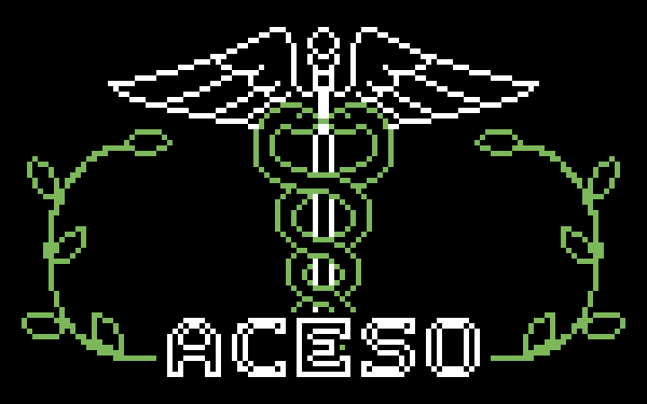

# 

MicroPython firmware for a heart rate variability (HRV) measurement device that uses photoplethysmography (PPG). The device reads the PPG signal through a pulse sensor and shows the results on an OLED display, with a rotary encoder and buttons for navigation.


## Features

- Live heart rate with the PPG waveform drawn on the display
- HRV analysis on the device: mean PPI, RMSSD and SDNN
- Sends measurements to Kubios over MQTT for SNS, PNS and stress index
- Saves results to a history, with separate patient profiles

## Team

- [AkseliHyv](https://github.com/AkseliHyv)
- [ptchtrns](https://github.com/ptchtrns)
- [MiroVart](https://github.com/mirovart)

The same repository can be found on ptchtrns' GitHub. This project is pulled from GitLab.

## Hardware

| Component | Part |
|---|---|
| Microcontroller | Raspberry Pi Pico W |
| Pulse sensor | Crowtail Pulse Sensor v2.0 |
| Display | SSD1306 OLED |
| Input | Rotary encoder and push buttons |

## Prerequisites

- A Raspberry Pi Pico W with MicroPython installed, connected over USB
- No other program, such as Thonny, connected to the board
- [mpremote](https://docs.micropython.org/en/latest/reference/mpremote.html) installed:

```bash
pip install mpremote
```

## Configure

Set the following in `app/config.py`:

| Field | Purpose |
|---|---|
| `DEVICE_NAME` | The name the device uses. |
| `SSID` | The Wi-Fi network to connect to. |
| `PASSWORD` | The Wi-Fi network's password. |
| `BROKER_IP` | The IP address of the MQTT broker used for Kubios analysis. |
| `BROKER_PORT` | The MQTT broker's port. |

The Pico W only supports 2.4 GHz networks, so the device cannot connect to a 5 GHz network.

## Install

Run the install script from the repository root:

```bash
./install.sh      # Linux/macOS
```

```powershell
.\install.cmd     # Windows
```

Both scripts run a clean push, which wipes the board's filesystem before copying the files.

## Sync files with the board

The repository includes sync scripts for Linux/macOS (`mpremote-sync.sh`) and Windows (`mpremote-sync.ps1`).
On Linux/macOS, make the script executable once:

```bash
chmod +x mpremote-sync.sh
```

| Action | Linux/macOS | Windows |
|---|---|---|
| Push local files to the board | `./mpremote-sync.sh push` | `.\mpremote-sync.ps1 push` |
| Wipe the board, then push | `./mpremote-sync.sh push --clean` | `.\mpremote-sync.ps1 push -Clean` |
| Pull all files from the board into `app/` | `./mpremote-sync.sh pull` | `.\mpremote-sync.ps1 pull` |

> **Warning:** `--clean` and `-Clean` permanently delete everything on the board's filesystem before pushing. Files on the board that do not exist locally are lost.

If the board is not detected automatically, pass its port:

```bash
./mpremote-sync.sh push --port /dev/ttyUSB0
./mpremote-sync.sh push --clean --port /dev/cu.usbmodem1101
```

```powershell
.\mpremote-sync.ps1 push -Port COM3
.\mpremote-sync.ps1 push -Clean -Port COM3
```

## Develop with Thonny

1. Clone the repository on your development machine.
2. Push the files to the board with `./mpremote-sync.sh push` or `.\mpremote-sync.ps1 push`.
3. Edit the code on the board in Thonny.
4. Pull the changes back to your machine with `./mpremote-sync.sh pull` or `.\mpremote-sync.ps1 pull`.

Use `--clean` or `-Clean` when pushing to make the board's filesystem match your local copy exactly.
